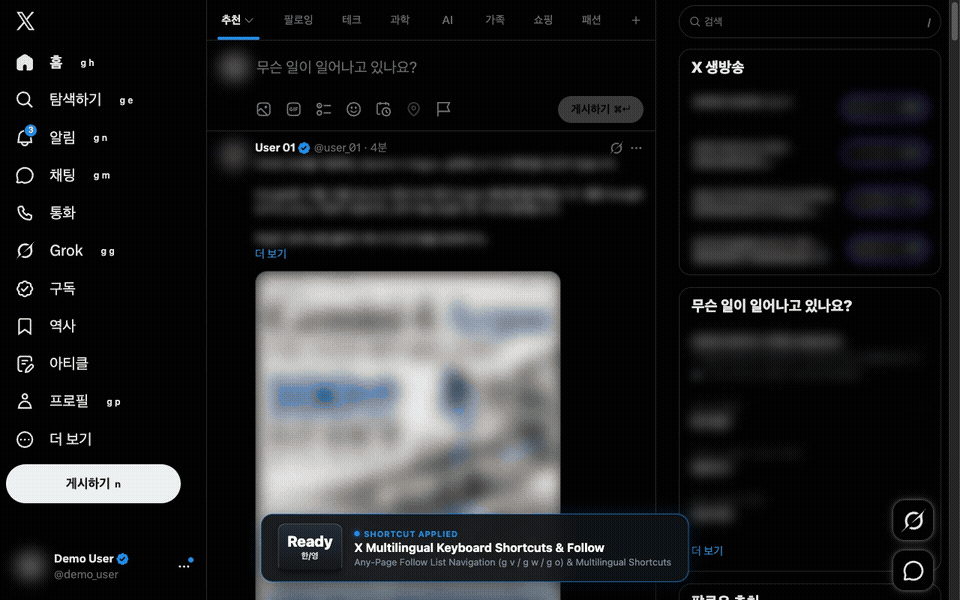
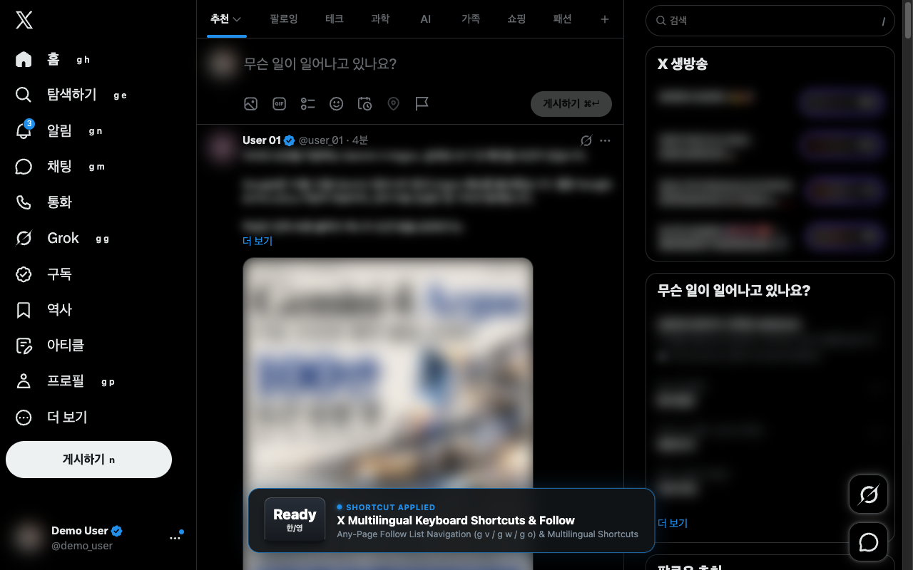
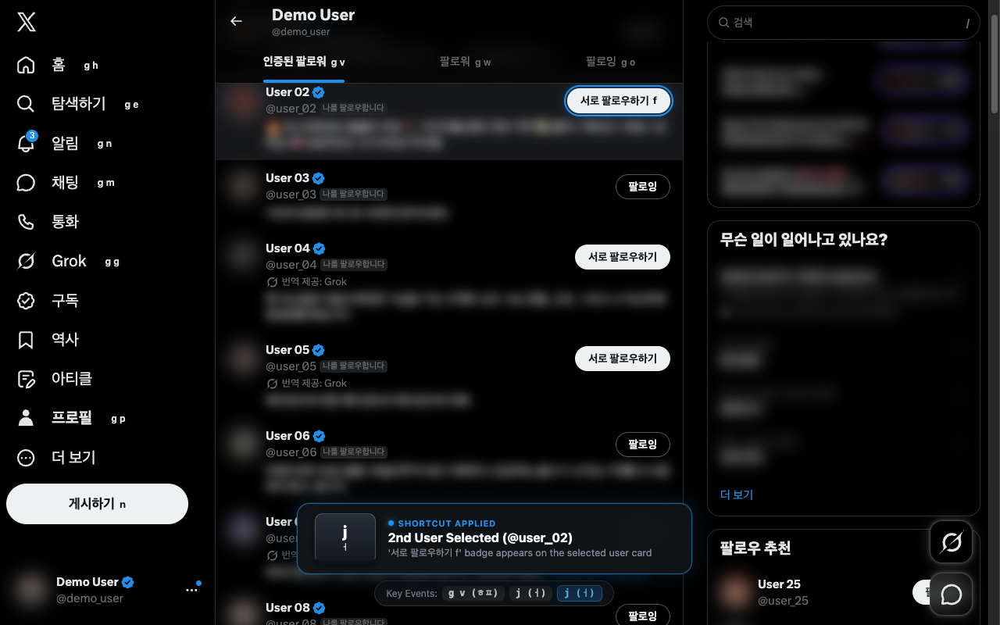
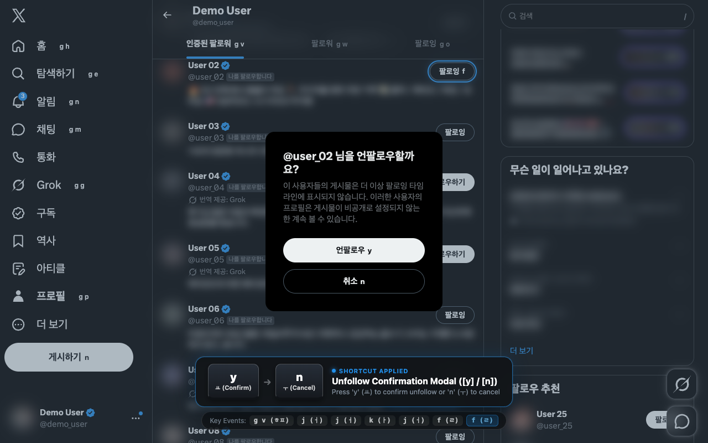
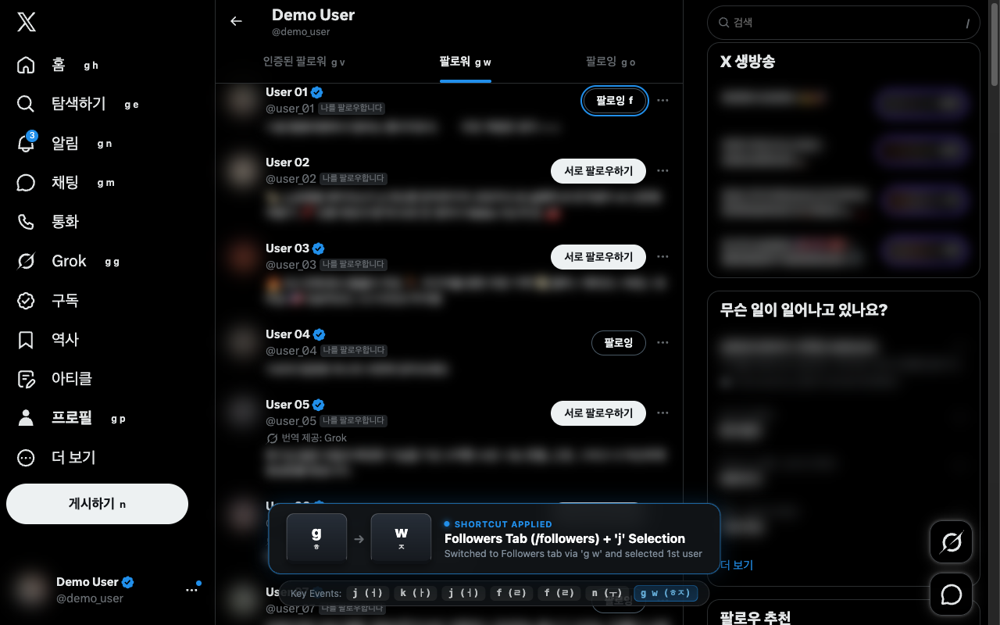

# X Multilingual Keyboard Shortcuts & Follow (한국어)

**언어 (Languages)**: [English](README.md) | [한국어](README.ko.md) | [中文](README.zh.md) | [日本語](README.ja.md)

한/영 키를 전환하지 않고 **한국어(한글), 일본어, 중국어 등 모든 다국어 입력 상태(IME)**에서 **X.com(트위터)의 전체 기본 단축키(`?`)**와 **팔로우/언팔로우(`F`)**, **확인 모달(`Y`/`N`)**, **팔로워/팔로잉 탭 이동(`G` `V` / `G` `W` / `G` `O`)** 단축키를 바로 사용할 수 있는 Chrome 확장 프로그램입니다.

---

## 시연 영상 (Demo Video)

> **[고화질 원본 MP4 영상 보기 / 다운로드 (`store-assets/demo-video.mp4`)](store-assets/demo-video.mp4)** — 화면 우측 하단에 실시간 입력 키 이벤트 HUD(`G + V`, `J / K`, `F`, `Y / N`, `G + W`, `G + O`)가 표시됩니다.

---

## 주요 기능

1. **팔로우 / 언팔로우 / 맞팔로우 단축키 (기본값: `F` / 한글 `ㄹ`)**
   - **프로필 및 게시물 상세(status) 페이지**: 프로필 페이지나 게시물 상세 화면에서 `F`(`ㄹ`)를 누르면 해당 계정의 **팔로우**, **팔로잉(언팔로우)**, **서로 팔로우하기(맞팔로우)** 버튼을 즉시 클릭합니다.
   - **팔로워·팔로잉 목록 (`/verified_followers`, `/followers`, `/following`)**: `J` / `K`(`ㅓ` / `ㅏ`)로 계정을 이동(길게 누르면 연속 이동 지원)한 뒤 `F`(`ㄹ`)를 눌러 선택된 계정을 팔로우·맞팔로우·언팔로우합니다.
   - **프로필 호버 카드**: 프로필 미리보기 카드가 열려 있을 때 `F`를 누르면 호버 카드 안의 팔로우 버튼을 우선 동작시킵니다.
2. **언팔로우·차단·뮤트 확인 모달 단축키 (`Y` / `N`)**
   - 확인 창이 떴을 때 마우스 없이 `Y`(`ㅛ`)로 확인, `N`(`ㅜ`)으로 취소할 수 있습니다.
3. **팔로워 / 팔로잉 탭 바로 이동 (`G` `V` / `G` `W` / `G` `O`)**
   - X.com 어느 화면에서나 `G` `V`(**인증된 팔로워**), `G` `W`(**팔로워**), `G` `O`(**팔로잉**)를 눌러 해당 탭으로 즉시 이동합니다.
4. **X.com (`?`) 전체 기본 단축키 다국어 IME 완벽 지원**
   - 한글(`ㅎ`, `ㅓ`, `ㅏ`, `ㅣ` 등), 일본어, 중국어, 러시아어, 아랍어, 전각 문자 입력 상태에서도 영문 전환 없이 모든 X 기본 단축키(`?`, `J`, `K`, `Space`, `.`, `N`, `/`, `L`, `R`, `T`, `S`, `B`, `U`, `X`, `Enter`, `O`, `I`, `M`, 인용 `E`, `G + H/E/N/R/P/F/T/L/I/M/G/C/S/B/U/D`, `A + D/Space/M`)가 그대로 작동합니다.
5. **화면 내 단축키 힌트 표시 / 숨기기 옵션**
   - 각 버튼·메뉴의 텍스트 색상에 맞춘 자연스러운 단축키 힌트를 표시하며, 팔로워/팔로잉 목록에서는 `J`/`K`로 선택된 행에만 `F` 힌트가 표시됩니다. 확장 프로그램 팝업에서 언제든 켜거나 끌 수 있습니다.
6. **팔로우 단축키 커스터마이징 및 입력창 자동 감지**
   - 팝업에서 팔로우 단축키를 원하는 단일 키 또는 조합키로 변경할 수 있으며, 게시물 작성창·답글·검색창·DM 입력 중에는 단축키가 동작하지 않습니다.

---

## 스크린샷

| 홈 화면 및 다국어 단축키 힌트 | 인증된 팔로워 목록 (`G + V`, `J / K`, `F`) |
| --- | --- |
|  |  |

| 언팔로우 확인 모달 (`Y / N`) | 팔로워 (`G + W`) 및 팔로잉 (`G + O`) 탭 이동 |
| --- | --- |
|  |  |

---

## 단축키 안내

### 확장 프로그램 추가 단축키

| 단축키 | 동작 설명 |
| --- | --- |
| `F` (`ㄹ`, 변경 가능) | 프로필 / 게시물 상세 / 호버 카드 / 목록에서 `J`·`K`로 선택한 계정 팔로우·언팔로우·맞팔로우 |
| `Y` / `N` (`ㅛ` / `ㅜ`) | 언팔로우·차단·뮤트 확인 모달에서 확인(`Y`) / 취소(`N`) |
| `G` → `V` (`ㅎ` → `ㅍ`) | **인증된 팔로워** (`/verified_followers`) 탭으로 이동 |
| `G` → `W` (`ㅎ` → `ㅈ`) | **팔로워** (`/followers`) 탭으로 이동 |
| `G` → `O` (`ㅎ` → `ㅐ`) | **팔로잉** (`/following`) 탭으로 이동 |
| `E` (`ㄷ`) | 재게시 메뉴를 열고 **인용(Quote)** 바로 선택 |

### X.com 기본 단축키 (한·일·중 다국어 자동 변환 지원)

| 단축키 | 동작 설명 |
| --- | --- |
| `?` / `.` | 단축키 도움말(`?`) / 새 게시물 불러오기(`.`) |
| `J` / `K` *(길게 누르기 지원)* | 다음 / 이전 게시물·계정 이동 |
| `Space` / `Enter` | 페이지 내리기(`Space`) / 선택한 게시물 상세 열기(`Enter`) |
| `N` / `⌘+Enter` | 새 게시물 작성(`N`) / 게시물 전송(`⌘+Enter`) |
| `/` | 검색창 포커스 |
| `L` / `R` / `T` | 마음에 들어요(`L`) / 답글(`R`) / 재게시(`T`) |
| `S` / `B` | 공유하기(`S`) / 북마크(`B`) |
| `U` / `X` | 계정 뮤트(`U`) / 계정 차단(`X`) |
| `O` / `I` / `M` | 사진 펼치기(`O`) / 쪽지함(`I`) / 동영상 음소거(`M`) |
| `G` + `H/E/N/R/P/F/T/L/I/M/G/C/S/B/U/D` | 홈, 탐색, 알림, 멘션, 프로필, 초안, 예약, 좋아요, 리스트, 채팅, Grok, 스튜디오, 설정, 북마크, 사용자, 표시 화면 이동 |

---

## 설치 방법

### Chrome / Edge / Brave / Arc
1. **Chrome 웹 스토어 설치**: [Chrome 웹 스토어 페이지](https://chromewebstore.google.com/detail/helbbdgikebbpbjjejmkkappejlhaglf)에서 바로 설치할 수 있습니다.
2. **수동 설치 (개발자 모드)**:
   - [GitHub Releases](https://github.com/hansonkim/x-multilingual-keyboard-shortcuts-and-follow/releases/latest)에서 `x-multilingual-keyboard-shortcuts-and-follow-chrome.zip`을 다운로드(또는 저장소 클론)합니다.
   - Chrome 주소창에 `chrome://extensions/` 입력 후 우측 상단 **개발자 모드** 활성화
   - **압축해제된 확장 프로그램을 로드합니다** 클릭 후 폴더 선택

### Safari (macOS / iOS) — Userscript 방식
1. App Store에서 무료 오픈소스 Safari 확장 프로그램인 [Userscripts](https://apps.apple.com/app/userscripts/id1463298887) 또는 [Stay](https://apps.apple.com/app/stay-for-safari/id1591620171) / Tampermonkey를 설치합니다.
2. [GitHub Releases](https://github.com/hansonkim/x-multilingual-keyboard-shortcuts-and-follow/releases/latest)에서 **[`x-multilingual-keyboard-shortcuts-and-follow.user.js`](https://github.com/hansonkim/x-multilingual-keyboard-shortcuts-and-follow/releases/latest/download/x-multilingual-keyboard-shortcuts-and-follow.user.js)** (또는 `x-multilingual-keyboard-shortcuts-and-follow-safari-userscript.zip`) 파일을 받아 Userscripts 폴더에 등록합니다.
3. Safari에서 `https://x.com`에 접속하면 모든 다국어 단축키(`?`), `F` 팔로우/언팔로우, `Y`/`N` 확인 모달, `G V/W/O` 탭 이동이 즉시 작동하며, Userscript 메뉴(`GM_registerMenuCommand`)에서 단축키 힌트 표시/숨기기와 팔로우 키 변경도 가능합니다.

---

## 개인정보 보호

이 확장 프로그램은 `https://x.com/*` 및 `https://twitter.com/*`에서만 실행되며, `chrome.storage`는 사용자의 단축키 설정을 로컬에 저장하는 용도로만 사용합니다. 어떠한 개인정보나 브라우징 기록도 외부로 수집하거나 전송하지 않습니다.
